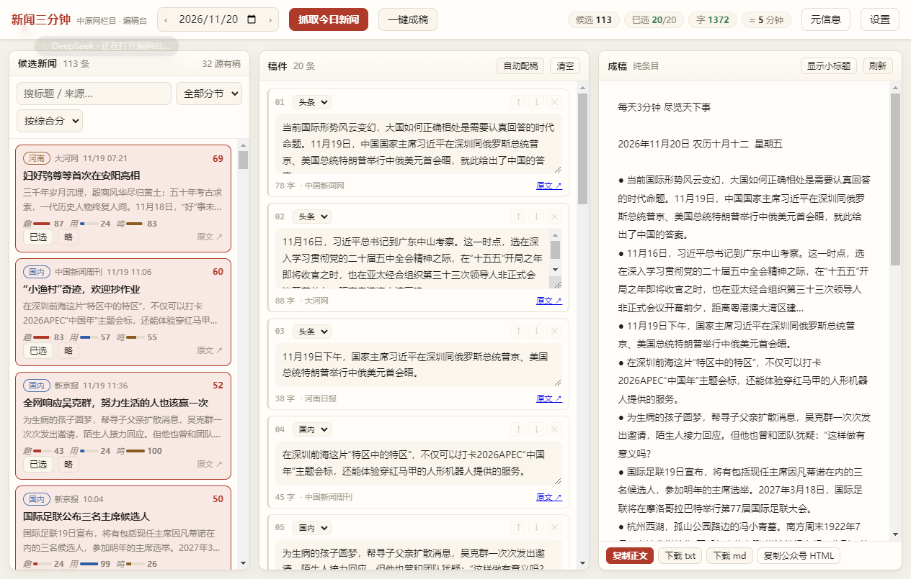

# 新闻三分钟 · DSH 编稿工作台

> Daily news-scouting and editing desk for the 「每天3分钟 尽览天下事」 column format: fetch from whitelisted Chinese media, score every candidate on **interesting / useful / resonant**, and draft the 20-item issue — with the source list restricted to China's official 《互联网新闻信息稿源单位名单》.

按中原网《每天3分钟 尽览天下事》的栏目形式，把「当天发生了什么、值不值得写」一次性整理成可发布的稿子。
左侧栏点「新闻三分钟」进入编稿台，**稿源严格限定在 2025 版《互联网新闻信息稿源单位名单》内**（1459 家）。



## 安装

```sh
# npm 包（发布后）
dsh plugin --profile web add dsh-news-3min

# 或直接从仓库装
dsh plugin --profile web add github:owner/dsh-news-3min
```

装完重启 DSH，左侧竖排菜单出现「新闻三分钟」。桌面端把 `--profile web` 换成 `--profile desktop`。

## 它替你做的四件事

1. **抓** —— 遍历名单内 46 个媒体站点（央媒 / 河南 / 郑州 / 都市 / 财经 / 科技 / 文化 / 健康 / 国际），
   从列表页拿文章链接、从正文页抽标题与正文，剥掉电头、责任编辑、图片署名、AI 免责声明、手机报聚合页。
2. **判** —— 每个候选按栏目编辑标准打三轴分：**有趣 / 有用 / 有共鸣**，综合分决定排序；
   自动分到「头条 / 国内 / 河南 / 郑州 / 财经 / 科技 / 文体 / 国际 / 民生 / 天气」各节，并做同题去重与分节配额，
   避免财经稿把候选池灌满。
3. **配** —— 「一键成稿」按栏目配额（头条 3、国内 5、河南 3、郑州 3、财经 2、科技 2、文体 2、国际 2、民生 2）凑出 20 条初稿，
   每条已经切好 40–100 字的 lead，直接可改。
4. **出** —— 右侧实时成稿视图：纯正文 / Markdown / 公众号可粘贴 HTML，一键复制或下载。

## 用法

1. 左侧栏点「新闻三分钟」。
2. 顶栏「抓取今日新闻」——约 5–8 秒，候选池出炉。
3. 左侧点「加入」，或直接「一键成稿」。
4. 中间改写每条 lead（自动保存），右侧看字数与预计播报时长（目标 20 条 / 1800 字 / 3 分钟）。
5. 元信息区填日期行、天气、限行、头条 A–D、结尾语、来源、编辑署名。
6. 右侧「复制正文」或「复制公众号 HTML」粘进公众号编辑器。

不在界面里也能干活：主会话里直接说「今天的新闻三分钟候选给我看看」，插件注册的 `news3min` 工具会返回候选、现稿或成稿。

## 每日自动抓取

默认每天 05:10（本地时区）自动抓一轮，落在数据目录 `days/<YYYY-MM-DD>.json`。
可在「设置」抽屉里改抓取时间、每源条数、并发、候选上限，以及是否启用模型打分。

## 模型（可选）

开启后模型会对前 90 条候选重打三轴分、纠正分节、写一句选稿理由；也可用「让模型拟头条」「让模型改写」。
模型走 DSH 自己的 LLM 服务（设置里选 provider/model），未配置时全部功能仍可用，只是少了这层润色。

## 合规

- 稿源名单版本：2025-08（中央网信办 2025-08-14 发布，共 1459 家）。
- 设置抽屉里内置名单检索：输入任意媒体名，立刻知道它在不在名单内。
- 不在名单内的站点（如大象新闻、顶端新闻、三联生活周刊等）不会被抓取。

## 数据位置

- 本机：`%USERPROFILE%\.dsh\news-3min\`（`days/`、`settings.json`、`sources.json`、`boot.log`）
- 也可用插件配置 `dataDir` 覆盖。

## 目录结构

```
lib/index.js     插件入口：HTTP 路由、定时抓取、news3min 工具
lib/client.js    客户端半体：左侧栏入口 + 主面板 iframe + 设置卡片
lib/service.js   抓取编排、稿件编辑操作、成稿预览
lib/http.js      fetch + 并发池（自动识别 gbk 站点）
lib/extract.js   列表页/正文页解析（htmlparser2）
lib/classify.js  分节判定、三轴打分、去重、摘要与 lead 清洗
lib/render.js    成稿渲染（纯文本 / Markdown / 公众号 HTML）与一键配稿
lib/ai.js        模型打分、拟头条、改写（可选）
lib/lunar.js     农历日期行
lib/store.js     按日 JSON 存储（原子写）
lib/sources.js   稿源登记表 + 名单元信息
lib/bootlog.js   启动诊断日志（~/.dsh/news-3min/boot.log）
data/whitelist-2025.txt  名单全文（用于合规检索）
web/             编稿台前端（无构建，原生 JS）
```

## 只用 Node 原生能力

不装定时器插件、不依赖 cordis 的 `timer` / `tools` 注入：定时用 `setInterval`，工具注册走 `ctx.get('tools')` 并容错。
插件条目因此不会因为服务注入缺失而 `fiber failed`（这是本插件开发中踩过的坑：条目 failed 时左侧栏既不显示、插件列表里也看不见）。

## 已知限制

- 名单只给单位名，不给网址；站点列表是逐个实测出来的，个别站点（澎湃、参考消息、环球网等）抓不到列表页，已在源表里剔除或标注。
- 郑州本地媒体官网多已改版/失效，郑州节主要靠「河南来源中标题含郑州」的稿件填充，抓不到时可手工补。
- 天气模块不自动抓取：名单内天气类站点不可用，请在元信息里手填。

## License

MIT
